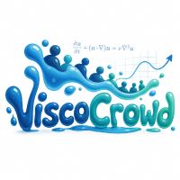
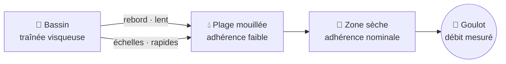

<div align="center">





<sub><i>Illustration animée, pas une sortie de simulation : 30 agents quittent le bassin par le rebord (lent) ou les échelles (rapides), traversent la plage mouillée en régulant mal leur trajectoire, puis se pressent vers une sortie unique.</i></sub>

<br><br>

[](https://github.com/ViscoCrowd/ViscoCrowd-simulation/actions/workflows/ci.yml)


</div>

---

## 🌊 La question

> **Comment la succession d'une extraction aquatique répartie et d'un goulot d'étranglement unique en milieu sec, couplée à l'inertie d'une zone de carrelage mouillé, altère-t-elle le diagramme fondamental débit/densité d'une foule en panique ?**

Une alarme retentit dans une piscine couverte. Tout le monde doit sortir, par la même porte. Entre l'eau et cette porte : un rebord, quelques échelles, et du carrelage mouillé. Deux intuitions s'opposent, et départager les deux est tout l'enjeu du projet.

<table>
<tr>
<td width="50%" valign="top">

### 🟢 Hypothèse « tampon »
Sortir de l'eau par le rebord ou les échelles, puis traverser la plage mouillée, **désynchronise** les arrivées. La densité de pointe au goulot baisse, et le débit **augmente**.

</td>
<td width="50%" valign="top">

### 🟠 Hypothèse « inertielle »
Sur un sol glissant, on ne régule plus son approche : on dépasse sa cible, on se percute. La densité effective au goulot **monte**, et le débit **s'effondre**, version aquatique du *faster-is-slower*.

</td>
</tr>
</table>

## 🏊 Trois milieux, une seule porte



| Milieu | Temps de relaxation τ | Accélération maximale a<sub>max</sub> | Ce que ça donne |
|---|---|---|---|
| 🌊 Eau | court | modérée | très amorti, mais lent : on s'arrête vite, on n'avance pas vite |
| 💧 Carrelage mouillé | long | **faible** | traction limitée : impossible de s'arrêter ou de tourner vite |
| 🧱 Sol sec | court | élevée | régulation nominale de la vitesse |

C'est le contraste entre l'a<sub>max</sub> du mouillé et celui du sec qui porte l'effet d'inertie étudié.

## 💧 Eau, foule, viscosité, en ASCII

<div align="center">

</div>

<sub>L'acte 2 n'est pas un dessin : c'est un petit automate cellulaire. Chaque <code>o</code> avance vers la porte s'il trouve une case libre ; sinon il reste sur place et devient un <code>@</code> orange. Le bouchon au goulot apparaît tout seul.</sub>

## 📈 La cible : le diagramme fondamental

<div align="center">

</div>

<sub>Courbe de Weidmann <b>calculée</b> avec les constantes du dépôt (v<sub>0</sub> = 1,34 m/s, γ = 1,913 pers/m², ρ<sub>max</sub> = 5,4 pers/m²) : maximum ≈ 1,22 pers/m/s à ρ ≈ 1,8 pers/m². Les deux courbes d'hypothèse sont <b>illustratives</b> : les mesurer est précisément l'objet des campagnes du jalon 5. Weidmann décrit la marche à pied : la courbe sert de référence pour les zones piétonnes, pas pour la nage.</sub>

## ⚙️ Le moteur en trois temps

Pas de moteur physique tout fait, pas de bibliothèque de foule : le schéma, les contraintes et les conditions aux limites sont écrits par nous.

1. **Pas libre** : chaque agent avance comme s'il était seul (schéma semi-implicite).
   $$v_{\text{libre}} = v^n + \Delta t\, a^n, \qquad x_{\text{libre}} = x^n + \Delta t\, v_{\text{libre}}$$
2. **Projection** : on ramène la foule dans les configurations admissibles, sans recouvrement et dans les murs.
   $$K = \lbrace\, X \;:\; |x_i - x_j| \ge r_i + r_j,\;\; x_i \in \Omega \,\rbrace$$
   *Configuration admissible obtenue par projections successives* (Jacobi vectorisé, extrapolation de Nesterov retardée).
3. **Relecture de la vitesse** : c'est ici que naît le choc mou.
   $$v^{n+1} = \frac{x^{n+1} - x^n}{\Delta t}$$
   Si la projection a bloqué un déplacement, elle a supprimé du même coup la vitesse correspondante.

<div align="center">

</div>

<sub>Extrait reformaté de <code>make valider</code> sur la branche <code>dev</code>. La commande échoue dès qu'un critère sort de son seuil.</sub>

## ✅ Des chiffres, pas des impressions

| Critère | Mesuré | Attendu |
|---|---:|---|
| Confinement d'une bille, Δt de 10⁻³ à 10⁻¹ s | **3,3 · 10⁻¹⁶ m** | précision machine |
| Remontée d'énergie en boîte fixe | **0 J** | ≤ 0, strictement |
| Recouvrement entre 36 agents qui s'empilent | **≤ 10⁻⁶ m** | sous la tolérance |
| Projections non convergées | **0 / 1500** | 0 |
| Entraînement solide d'une bille en boîte tournante | seulement si **ω²R/g ≳ 1** | résultat non trivial |

Limite connue et suivie : un jeu d'environ 1,7 mm subsiste quand trois agents se touchent mutuellement ([#10](https://github.com/ViscoCrowd/ViscoCrowd-simulation/issues/10)). À corriger ou à borner avant les campagnes.

## 🗺️ Où on en est

<div align="center">

</div>

## 👥 L'équipe

<div align="center">

<a href="https://github.com/CodeByHaamza"></a>
<a href="https://github.com/shalee-pnt"></a>
<a href="https://github.com/lennymgrd"></a>

<sub>Encadrement : O. Pantz · R5.12 Modélisation mathématique · BUT 3 Informatique · 2026–2027</sub>

</div>

## 📦 Dépôts

| Dépôt | Contenu |
|---|---|
| [**ViscoCrowd-simulation**](https://github.com/ViscoCrowd/ViscoCrowd-simulation) | moteur, scénarios, observables, tests et invariants physiques, rapport LaTeX |
| [**.github**](https://github.com/ViscoCrowd/.github) | cette page, et les scripts qui génèrent ses animations |

```bash
git clone https://github.com/ViscoCrowd/ViscoCrowd-simulation.git
cd ViscoCrowd-simulation
make install
make valider   # rejoue tous les critères chiffrés, rend 1 si l'un d'eux échoue
```

<div align="center">
<br>
<sub>Une simulation qui tourne n'est pas une simulation juste. 🌊</sub>
</div>
